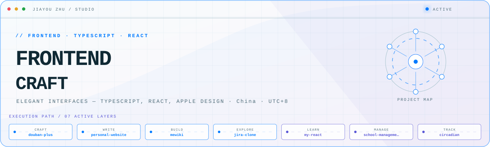
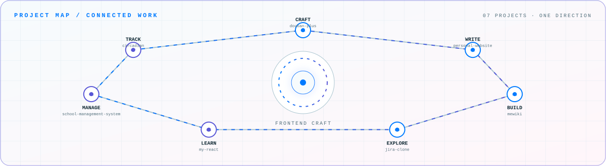

<picture>
  <source media="(prefers-color-scheme: dark)" srcset="assets/hero-dark.svg">
  <source media="(prefers-color-scheme: light)" srcset="assets/hero-light.svg">
  
</picture>

 

Elegant interfaces — TypeScript, React, Apple Design

## Featured projects

| Repository | Role | Purpose |
| --- | --- | --- |
| [`douban-plus`](https://github.com/ZlatanCN/douban-plus)  | CRAFT | Apple TV style dark UI for Douban movie pages — Preact Apple Design re-theme with native login and discussion preserved |
| [`personal-website`](https://github.com/ZlatanCN/personal-website)  | WRITE | Personal site and technical blog exploring JavaScript engines, browser rendering, and frontend fundamentals |
| [`mewiki`](https://github.com/ZlatanCN/mewiki)  | BUILD | Personal knowledge management wiki system |
| [`jira-clone`](https://github.com/ZlatanCN/jira-clone)  | EXPLORE | Full-stack project management clone built with React and TypeScript |

## Project map

<picture>
  <source media="(prefers-color-scheme: dark)" srcset="assets/closed-loop-dark.svg">
  <source media="(prefers-color-scheme: light)" srcset="assets/closed-loop-light.svg">
  
</picture>

## Module registry

<strong>Frontend</strong> · 3 modules

| Module | Purpose |
| --- | --- |
| [`douban-plus`](https://github.com/ZlatanCN/douban-plus) | Apple TV style dark UI Preact re-theme for Douban |
| [`my-react`](https://github.com/ZlatanCN/my-react) | React internals learning project |
| [`jira-clone`](https://github.com/ZlatanCN/jira-clone) | Jira clone with React \+ TypeScript |

<strong>Knowledge</strong> · 2 modules

| Module | Purpose |
| --- | --- |
| [`personal-website`](https://github.com/ZlatanCN/personal-website) | Technical blog and portfolio built with Next\.js \+ MDX |
| [`mewiki`](https://github.com/ZlatanCN/mewiki) | Personal wiki and knowledge management system |

<strong>Systems</strong> · 3 modules

| Module | Purpose |
| --- | --- |
| [`circadian`](https://github.com/ZlatanCN/circadian) | Circadian rhythm tracking application |
| [`school-management-system`](https://github.com/ZlatanCN/school-management-system) | School administration management platform |
| [`chat_with_me`](https://github.com/ZlatanCN/chat_with_me) | Real-time chat application |

<strong>Academic</strong> · 3 modules

| Module | Purpose |
| --- | --- |
| [`UCB-CS61A-Fall-2020`](https://github.com/ZlatanCN/UCB-CS61A-Fall-2020) | CS 61A: Structure and Interpretation of Computer Programs |
| [`UCB-Data100-Spring-2022`](https://github.com/ZlatanCN/UCB-Data100-Spring-2022) | Data100: Principles and Techniques of Data Science |
| [`SCAU-OJ`](https://github.com/ZlatanCN/SCAU-OJ) | SCAU Online Judge problem solutions |

<a href="https://jiayoudev.vercel.app">Website</a> · <a href="https://github.com/ZlatanCN">GitHub</a> · <a href="mailto:wr1604010213@outlook.com">Email</a>

<!-- Generated by profile-control-plane. Edit profile.yaml, not this file. -->
